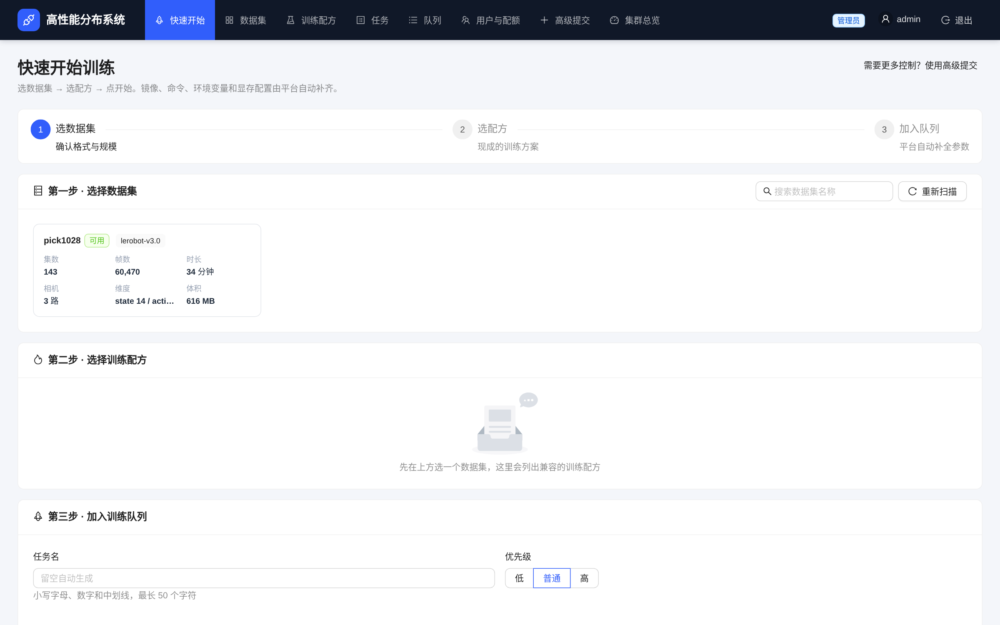
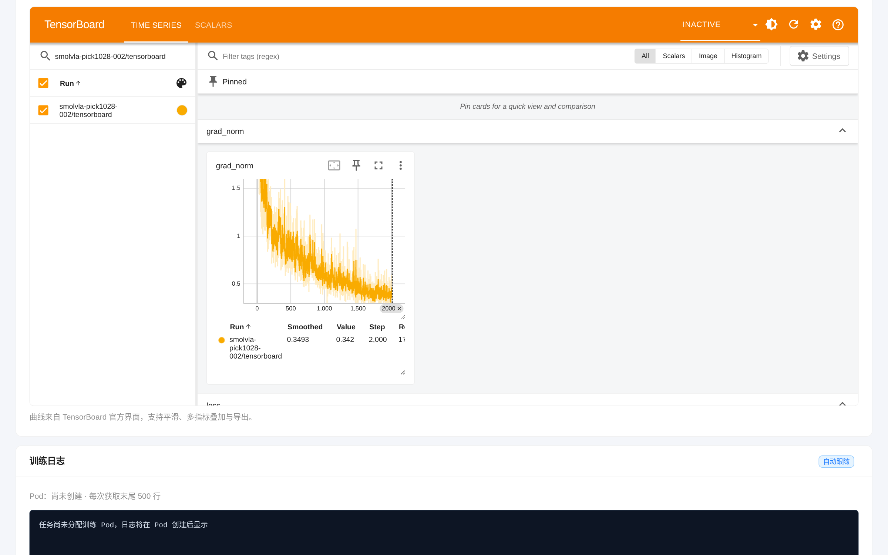
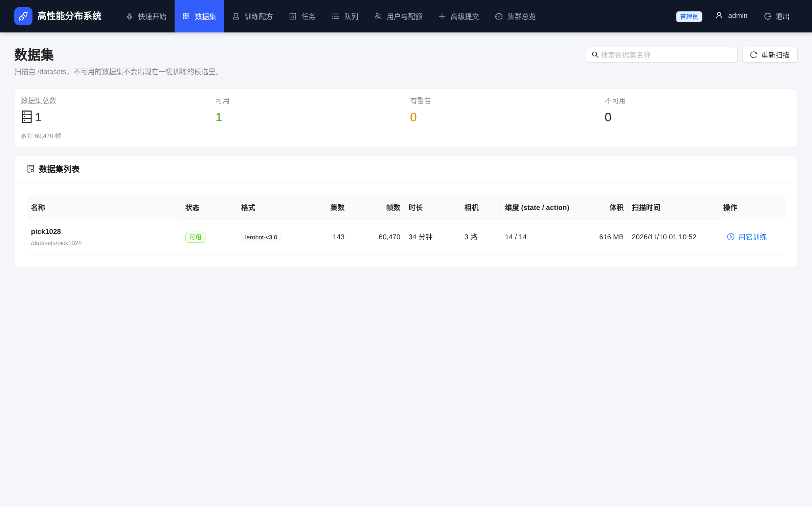
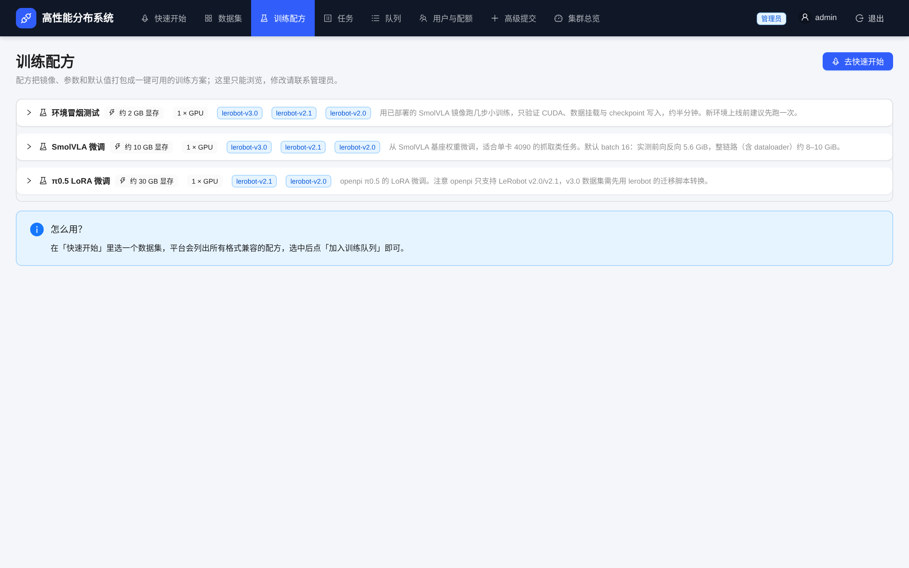
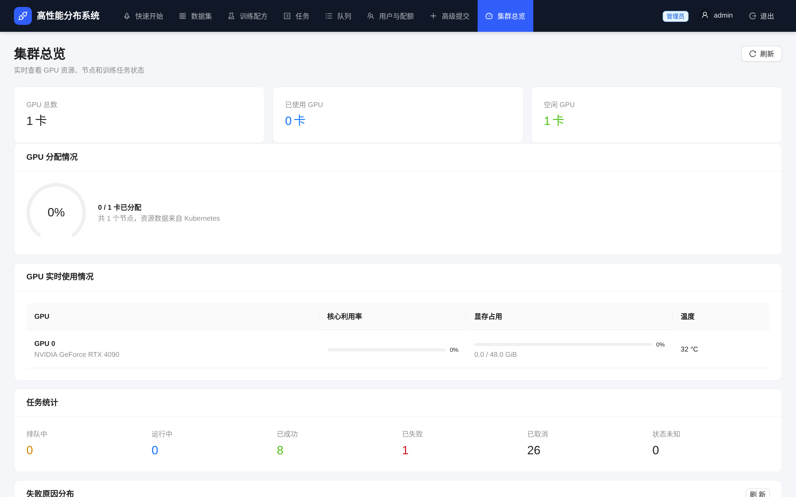

# 高性能分布系统

面向 VLA（Vision-Language-Action）模型训练的 GPU 训练平台。

用户只需要做三件事：**选数据集 → 选训练配方 → 点开始**。平台自动补齐镜像、命令、
参数和资源申请，把任务送进队列，等 GPU 空出来后自动开始训练。训练过程中的损失曲线、
梯度范数、学习率和每步耗时可以实时查看，任务结束后自动推送通知。

## 为什么需要它

VLA 模型训练的门槛不在写训练脚本，而在下面这些琐碎但容易出错的事：

- 显存到底要多少？batch size 调多大？学习率怎么设？
- 数据集格式对不对？LeRobot v2 还是 v3？相机数量匹配吗？
- 镜像去哪找？依赖装好了吗？模型权重下好了吗？
- 多个任务抢一张卡时谁先跑？怎么保证不互相打断？
- 训练跑了几小时，我怎么知道它失败了？

这些问题的答案散落在文档、聊天记录和某个人的电脑里。本平台把它们变成产品里的默认值：
配方预设了经过验证的参数组合，数据集会被自动识别和校验，镜像已备好运行环境，
队列按配额自动调度，失败原因会被自动诊断并推送。

## 核心能力

### 一键训练

选数据集、选配方、点开始。不需要写命令行参数，不需要拼 Kubernetes 清单。
需要精细控制时可以进「高级提交」，但绝大多数场景不需要。

### 训练配方

配方是一套经过验证的训练方案，包含镜像、入口命令、参数默认值和建议显存。
当前提供：

| 配方 | 说明 |
|---|---|
| SmolVLA 微调 | 从 SmolVLA 基座权重微调，适合单卡 4090 的抓取类任务 |
| π0.5 LoRA 微调 | OpenPI 的 LoRA 微调方案 |
| 环境冒烟测试 | 跑几步小训练，验证 CUDA、数据挂载和存盘是否正常 |

每个参数都有说明和推荐值，也支持覆盖。

### 数据集管理

平台自动识别 LeRobot 格式的数据集，校验结构完整性和与配方的兼容性。
管理员可以把新数据集注册进平台，不需要手动改服务器上的文件。

提交任务前会做预检：数据集是否存在、格式是否匹配、显存是否够、镜像是否可用。
有问题在提交前就说清楚，而不是等任务跑起来才发现。

### 排队与调度

多个任务共享 GPU 时，平台按队列配额自动调度：GPU 空闲就自动开始，
被占用就排队等待，不会因为抢不到资源而失败。支持按用户设置 GPU 数量和任务数配额。

### 训练监控

- **实时指标**：损失、梯度范数、学习率、每步耗时
- **训练曲线**：支持平台指标和 TensorBoard 两种数据源
- **训练日志**：自动跟随最新输出
- **事件与时间线**：任务从提交到结束的完整过程
- **失败诊断**：显存不足、数据集错误、镜像拉取失败等问题自动给出原因和处理建议

### 断点续训

训练可以从中断处继续，不需要从头开始。模型权重定期保存，续训时自动接续步数。

### 任务通知

任务成功或失败时推送到钉钉、企业微信或自定义 Webhook，
包含任务名、状态、耗时、产物目录等信息。不需要一直盯着页面。

## 界面预览

### 快速开始：选数据集 → 选配方 → 开始



### 训练监控：TensorBoard 曲线

任务详情页直接嵌入 TensorBoard 官方界面，支持平滑、多指标叠加、直方图与数据导出。



### 数据集管理



### 训练配方



### 集群总览



## 使用流程

1. 打开平台地址，用账号登录
2. 在「快速开始」页选择数据集
3. 选择匹配的训练配方
4. 确认参数（可以对默认值做调整）
5. 点「加入训练队列」

任务进入队列后会自动调度。在「任务」页可以看到进度、日志和指标，
任务结束后可以下载模型权重。

## 系统架构

```
浏览器
   │
   ▼
Web 服务（API + 前端页面）
   │
   ▼
任务队列（按 GPU 配额排队）
   │
   ▼
训练任务（Kubernetes Job）
   │
   ▼
GPU（NVIDIA 加速卡）
```

任务状态以集群中的实时状态为准，提交和操作记录持久化保存。

## 支持的数据集

- LeRobot v2.x / v3.0 格式
- 多相机视频、动作片段、语言指令等标准字段
- 自动识别 episode 数、帧数、相机数量和分辨率

## 部署

部署需要 Kubernetes 集群和支持的 NVIDIA GPU。详见 [训练环境配置](docs/training-env-guide.md)
与 [运维手册](docs/operations.md)。

主要组件：

- Kubernetes 集群
- NVIDIA Device Plugin（GPU 调度）
- 任务队列组件（GPU 配额与排队）
- 训练任务控制器
- Web 服务（单容器，内含 API 与前端）

## 文档

| 文档 | 内容 |
|---|---|
| [用户手册](docs/user-guide.md) | 页面和 CLI 的完整使用说明 |
| [训练参数](docs/smolvla-training-params.md) | SmolVLA 各参数的实测数据和推荐值 |
| [数据集格式](docs/vla-dataset-format.md) | 支持的格式和校验规则 |
| [API 文档](docs/api.md) | 后端接口说明 |
| [训练环境配置](docs/training-env-guide.md) | 环境准备与部署 |
| [运维手册](docs/operations.md) | 备份、恢复、清理、故障处理 |
| [断点续训](docs/resume-training.md) | 续训的使用方法和注意事项 |
| [常见问题](docs/troubleshooting.md) | 典型故障排查 |

## 开发

```
backend/    后端服务（Python / FastAPI）
frontend/   前端页面（React / Ant Design）
deploy/     Kubernetes 部署清单
images/     训练镜像构建
recipes/    训练配方定义
scripts/    运维脚本
docs/       文档
cli/        命令行工具
```

运行测试：

```bash
# 后端
cd backend && pytest

# 前端
cd frontend && npm test
```

## 许可

内部项目，未经许可请勿外传。
